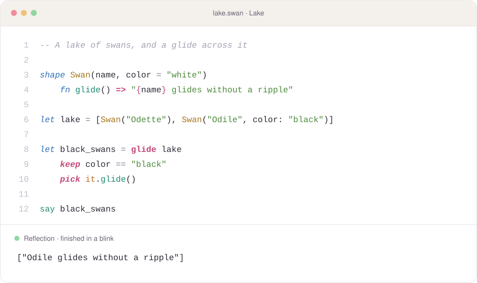

<picture>
  <source media="(prefers-color-scheme: dark)" srcset="assets/banner-dark.svg">
  
</picture>

<p align="center">
  <a href="https://github.com/advaithsajith/swan/actions/workflows/check.yml"></a>
  
  
  
  <a href="LICENSE"></a>
</p>

<p align="center">
  <b>Code that reads like a sentence, glides like a pipeline, and tells you kindly what went wrong.</b>
</p>

<p align="center">
  <a href="https://advaithsajith.github.io/swan/lake/"></a>
</p>

<p align="center">
  <a href="#try-it-in-lake-the-swan-editor">Install it</a> ·
  <a href="GUIDE.md">Learn it</a> ·
  <a href="#the-language">Language tour</a> ·
  <a href="#libraries">Libraries</a> ·
  <a href="examples">Examples</a>
</p>

<br>

<picture>
  <source media="(prefers-color-scheme: dark)" srcset="assets/code-dark.svg">
  
</picture>

## Why Swan?

<table>
  <tr>
    <td width="33%" valign="top"><h3>💬 Kind errors</h3>Points at the exact spot, explains what went wrong in plain words, and suggests the fix.</td>
    <td width="33%" valign="top"><h3>🌊 glide</h3>Data processing that reads like a sentence: <code>keep</code>, <code>sort</code>, <code>pick</code>, <code>group</code>.</td>
    <td width="33%" valign="top"><h3>🦢 flock</h3>Run several jobs at the same time, safely. Errors never get lost.</td>
  </tr>
  <tr>
    <td valign="top"><h3>🧩 Shapes &amp; abilities</h3>All four pillars of OOP: <code>hidden</code>, <code>from</code>, outlines and polymorphism.</td>
    <td valign="top"><h3>🎯 Choices &amp; match</h3>Swan checks that every case is handled, so a forgotten case can't slip through.</td>
    <td valign="top"><h3>🏞️ Lake editor</h3>Run, test, live error markers, auto-docs, and two themes, all in your browser.</td>
  </tr>
</table>

**New to programming?** Start with [GUIDE.md](GUIDE.md): fifteen short lessons with exercises.

---

## Try it in Lake, the Swan editor

**No install:** open [Lake in your browser](https://advaithsajith.github.io/swan/lake/). Swan runs right
inside the page; your files are saved in your browser.

**On your computer** you only need Python 3.8 or newer. Download this repository, then from its folder run:

```bash
python swan.py lake
```

On Windows you can also type `swan lake`.

Lake opens in your browser and runs only on your computer. You get:

* **Run** (`Ctrl+Enter`), with output shown live in the **Reflection** panel while your program runs.
* **Test** (`Ctrl+Shift+Enter`) runs every `test` block and shows ✓ or ✗ for each.
* **Error markers while you type.** Mistakes get a red squiggle, and the exact line and a hint appear when you run.
* **Docs tab:** documentation for your code, built automatically.
* **Input tab:** answers for programs that use `ask()`.
* **Two themes:** Black Swan (dark) and Swan Lake (light).
* **Typing help:** auto-indent, `Tab` and `Shift+Tab`, `Ctrl+/` to comment out lines, `Ctrl+S` to save, and Stop for programs that never end.

---

## Other ways to run Swan

| Command | What it does |
|---|---|
| `swan lake` | opens the editor |
| `swan program.swan` | runs a program |
| `swan test program.swan` | runs the program's tests |
| `swan docs program.swan` | writes `program.md`, documentation for your code |
| `swan` | opens the playground in the terminal |

Each of these also works as `python swan.py …`.

---

## Swan words

Some of Swan's words come from the lake itself:

| Word | Meaning |
|---|---|
| `glide` | process data step by step, like a swan gliding across water |
| `flock` | run several things at the same time, flying together |
| `shape … from …` | a shape that comes from another one, the way a cygnet comes from a swan |
| `ability` / `can` | what a shape is able to do: `shape Swan can Glide, Sing` |
| **Lake** | the editor |
| **Reflection** | the panel where your program's output appears |
| **Black Swan** / **Swan Lake** | the two themes |

---

## The language

### Values
```swan
let name = "Odette"      -- let: stays the same forever
var count = 0            -- var: allowed to change
count += 1

say "Hello, {name}! Count is {count}."
```
Maths behaves the way you'd expect: `7 / 2` is `3.5`, `6 / 2` is `3`, and `0.1 + 0.2` is `0.3`.

### Functions
```swan
fn greet(who, greeting = "Hello")
    say "{greeting}, {who}."

greet("Siegfried", greeting: "Good evening")

fn square(n) => n * n             -- one-line function
let double = n => n * 2           -- tiny unnamed function
```
The last line of a function is its answer. Functions can be used before they're written.

### Lists, ranges and pipelines
```swan
for n in 1..5          -- 1 to 5
for n in 10..1         -- counts down by itself
for n in 0..100 by 10  -- steps
for i, item in list    -- position and item together

nums |> keep(n => n > 10) |> map(square) |> sum |> say
[n * 2 for n in nums if n > 10]
```

### glide: data processing that reads like a sentence
```swan
let adults = glide people
    keep age >= 18          -- fields are just names inside each step
    sort name               -- or: sort age descending
    pick email              -- turn each one into something else

let cities = glide people
    group city              -- gives {key, items} for each city
    pick "{key}: {length(items)} people"
```
The steps are `keep`, `drop`, `sort`, `pick`, `first`, `last`, `unique`, `reverse` and `group`.
Inside a step, `it` means the whole item.

### Match: a smarter switch
```swan
let size = match n
    0 => "none"
    1..9 => "a few"
    [first, ...rest] => "a list starting with {first}"
    x if x < 0 => "below zero"
    _ => "plenty"
```

### Shapes, families and abilities (polymorphism)
```swan
ability Glide
    fn glide()                                  -- required: every glider writes this
    fn perform() => "{name}: {glide()}"         -- free for every glider

shape Bird(name)
    fn describe() => "{name} is a bird"

shape Swan(name) from Bird can Glide
    fn glide() => "glides without a ripple"

shape Cygnet from Swan                          -- gets everything a Swan has
    fn glide() => "paddles in circles"
    fn describe() => parent.describe() + ", still fluffy"

for thing in [Swan("Odette"), Cygnet("Pip")]
    say thing.perform()                         -- each one glides its own way

if pip is Swan ...                              -- true for Cygnets too
fn race(a: Glide, b: Glide)                     -- accepts anything that can Glide
```
If a shape says it `can Glide` but forgets `glide()`, Swan tells you the moment the program starts.

All four pillars of object-oriented programming are here:

| Pillar | In Swan |
|---|---|
| **Encapsulation** | `hidden` fields and functions: calm above the water, paddling out of sight below |
| **Inheritance** | `shape Cygnet from Swan`, with `parent.` to reach the original |
| **Abstraction** | outline shapes (a `fn` with no body) and abilities |
| **Polymorphism** | one call such as `thing.glide()`, many answers; `is` and ability types |

```swan
shape BoxOffice(show, hidden seats = 100)
    fn sell(count)
        if count > seats then fail "only {seats} left"
        seats -= count

office.seats = 5000     -- ✗ 'seats' is hidden inside BoxOffice.
```

### Choices: one of a few options
```swan
choice Weather
    Sunny
    Rain(mm: number)
    Storm(wind: number, mm: number)

fn advice(today: Weather)
    match today
        Sunny => "Perfect for gliding."
        Rain(mm) => "{mm}mm of rain"
        Storm(wind, _) => "Stay home"
```
**Swan checks that you handled every option.** Forget `Storm`, and Swan says so, even on a sunny day.

### Types, only where you want them
```swan
let age = 16                      -- Swan works out that this is a number
let wingspan: number = 2.3        -- or say so, and Swan guards it
fn area(radius: number) -> number
fn find(name: text) -> number?    -- ? means "or nothing"
if x is number ...
```
A plain `number` can never secretly be `nothing`. The `?` makes "might be missing" visible, and
`?.` and `??` handle it safely:
```swan
say person?.address?.city ?? "unknown"
```

### Refs: pointers without the danger
```swan
var score = 10
let p = ref score
@p += 5                         -- score is now 15

fn add_bonus(target, amount)
    @target += amount
add_bonus(ref score, 100)
```
Refs can never be empty, can never point at something that's gone, and can't change a `let`.

### flock: doing several things at once
```swan
flock
    weather = fetch_weather("Oslo")       -- all three run at the same time
    tickets = fetch_tickets("Swan Lake")
    swans = count_swans()
say weather                               -- all ready here

let task = spawn slow_job()               -- or start one yourself…
say await task                            -- …and collect its answer later
```
Tasks take turns safely, so two tasks can never scramble the same value. If a task fails, its error
always reaches you; Swan never lets it disappear.

### When things go wrong
```swan
try
    risky()
otherwise problem
    say "Caught it: {problem}"

fail "something is wrong"         -- raise your own problem
```

### Tests and docs live next to your code
```swan
--- Works out the area of a circle.
fn area(radius: number) -> number
    pi * radius ** 2

test "area of a unit circle"
    expect round(area(1), 2) == 3.14
```
Lines that start with `---` are documentation. The Docs tab and `swan docs` show them, and so does
`help(area)`. A failing test shows both sides: `left side was 3.14, right side was 3.15`.

---

## Built-in tools

| | |
|---|---|
| **Showing & asking** | `say` `ask` `text` `number` `type` `help` |
| **Numbers** | `round` `floor` `ceil` `abs` `sqrt` `min` `max` `sum` `average` `random` `pi` |
| **Lists** | `length` `map` `keep` `drop` `fold` `find` `any` `all` `count` `sort` `reverse` `unique` `zip` `first` `last` `push` `pop` `insert` `remove` `copy` |
| **Text** | `upper` `lower` `trim` `split` `join` `replace` `chars` `words` `lines` `starts_with` `ends_with` `contains` |
| **Maps** | `keys` `values` `has` `get` |
| **Time & files** | `now` `wait` `read_file` `write_file` |

Any tool can be written with dots: `length(name)` is the same as `name.length()`.

---

## Libraries

Libraries are extra tools, written in Swan itself, that you bring in with `use`. There are 57 of them, from fractions and JSON to a maze generator:

```swan
use maths                          -- then maths.gcd(12, 18)
use maths as m                     -- a shorter name: m.primes(30)
use box, bars from draw            -- or pick just the tools you want

say box("Swan Lake census", title: "1877")
say bars({swans: 24, ducks: 15, herons: 3})
```
```
┌─ 1877 ───────────┐
│ Swan Lake census │
└──────────────────┘
swans  │████████████████████ 24
ducks  │█████████████ 15
herons │███ 3
```

**Numbers and maths**

| Library | What it's for | Tools |
|---|---|---|
| **maths** | Number helpers: whole-number tricks, primes, and simple statistics | `gcd` `lcm` `is_even` `is_odd` `is_prime` `primes` `factors` `factorial` `fibonacci` `digits` `clamp` `lerp` `percent` `median` `mode` `spread` `deviation` |
| **trig** | Angles and triangles: sin, cos and tan, their opposites, and turning degrees into radians | `sin` `cos` `tan` `degrees` `radians` `atan` `atan2` `asin` `acos` `hypot` |
| **geometry** | Shapes and space: points, areas, volumes and triangles | `Point` `circle_area` `circle_circumference` `rectangle_area` `triangle_area` `heron` `is_right_triangle` `polygon_area` `sphere_volume` `cube_volume` `cylinder_volume` `cone_volume` |
| **fractions** | Fractions that stay exact: Fraction(1, 2).add(Fraction(1, 3)) is 5/6, not 0.8333 | `simplify` `Fraction` `fraction_of` |
| **vectors** | Vectors: arrows with a length and a direction, for movement, forces and games | `Vec` `distance` `lerp` |
| **matrix** | Matrices: grids of numbers you can add, multiply and flip, written as lists of lists | `make` `identity` `size` `add` `subtract` `scale` `multiply` `transpose` `determinant` `show` |
| **stats** | Statistics beyond the average: spread, percentiles, correlation and summaries | `variance` `deviation` `percentile` `quartiles` `iqr` `z_scores` `correlation` `covariance` `moving_average` `normalize` `summary` |
| **sequences** | Famous number patterns: triangular and square numbers, Collatz, Pascal's triangle and more | `triangular` `squares` `cubes` `collatz` `collatz_steps` `pascal` `arithmetic` `geometric` `is_perfect` `perfect_numbers` `happy` `look_and_say` |
| **combos** | Counting and listing the ways things can be arranged: combinations, permutations and more | `choose` `permutations_count` `permutations` `combinations` `powerset` `product` |
| **solve** | Solving equations: straight lines, quadratics, pairs of equations and anything by bisection | `linear` `quadratic` `proportion` `simultaneous` `root` |
| **physics** | School physics: speed, forces, energy, falling things and Ohm's law | `g` `speed_of_light` `speed` `distance` `time_taken` `acceleration` `momentum` `force` `weight` `kinetic_energy` `potential_energy` `density` `fall_time` `fall_speed` `ohms_law` |
| **roman** | Roman numerals: turning numbers into MMXXVI and back again | `to_roman` `from_roman` `is_roman` |
| **bases** | Numbers in other bases: binary, hex, anything from base 2 to 36, and bit-by-bit logic | `to_base` `from_base` `to_binary` `from_binary` `to_hex` `from_hex` `bits` `bit_and` `bit_or` `bit_xor` |
| **finance** | Interest, loans and savings: how money grows (or shrinks) over time | `compound` `simple_interest` `years_to_double` `inflation_adjust` `loan_payment` `total_interest` `payoff_months` `future_value` |
| **money** | Money: showing amounts nicely, splitting bills, tips, tax, discounts and giving change | `format` `parse` `round_cents` `split_bill` `tip` `with_tax` `discount` `change_for` |

**Text**

| Library | What it's for | Tools |
|---|---|---|
| **prose** | Playing with text: capital letters, counting, wrapping, slugs, ciphers and plurals | `capitalize` `title_case` `is_palindrome` `count_of` `vowels` `is_blank` `acronym` `shorten` `wrap` `indent` `slug` `pig_latin` `caesar` `plural` `ordinal` `with_commas` `pad_zeros` |
| **spell** | Numbers and times in words: spell.number(42) is "forty-two" and spell.time(3, 30) is "half past three" | `number` `ordinal_words` `time` |
| **wordplay** | Word games: anagrams, pangrams, Scrabble scores, rhymes and letter counting | `alphabetical` `is_anagram` `anagrams` `is_pangram` `is_isogram` `letter_frequency` `scrabble_score` `hidden_word` `longest_word` `word_lengths` `rhymes_with` |
| **cipher** | Secret codes: rot13, atbash, the Vigenère cipher, rail fences and letter substitution | `rot13` `atbash` `reverse_words` `vigenere` `unvigenere` `rail_fence` `unrail_fence` `substitution` `unsubstitution` |
| **morse** | Morse code: dots and dashes, there and back again | `table` `encode` `decode` `is_morse` `sound` |
| **diff** | Comparing text: how different two things are, what they share, and what changed between them | `levenshtein` `similarity` `closest` `common_prefix` `common_suffix` `longest_common_subsequence` `changes` `show` `words_changed` |
| **template** | Filling in the blanks: text with {name} placeholders, filled from a map | `placeholders` `missing` `fill` `fill_all` `fill_each` |
| **markdown** | Writing Markdown: headings, lists, tables, links and code, ready to save as a .md file | `heading` `quote` `link` `bold` `italic` `code` `code_block` `bullets` `numbered` `checklist` `table` `to_text` |
| **emoji** | Emoji by name, ratings made of stars, and faces for moods | `of` `names` `has_emoji` `replace_names` `any_emoji` `faces` `rate` `mood` |

**Lists and data**

| Library | What it's for | Tools |
|---|---|---|
| **lists** | Extra tools for lists: taking pieces, reshaping, grouping and counting | `take` `take_last` `rest` `chunk` `windows` `flatten` `compact` `without` `rotate` `interleave` `transpose` `index_of` `tally` `group_by` `partition` `max_by` `min_by` `sum_by` |
| **sets** | Sets: lists treated as collections of different things, with union, intersection and difference | `to_set` `equal` `union` `intersection` `difference` `symmetric_difference` `is_subset` `is_superset` `is_disjoint` |
| **search** | Finding things in lists: where an item is, which items match, and the nearest number | `linear_search` `binary_search` `insertion_point` `nearest` `find_all` `find_index` `first_where` `last_where` `contains_all` `is_sorted` |
| **sorting** | Sorting, done by hand: the classic ways to put a list in order, written out so you can read them | `bubble_sort` `selection_sort` `insertion_sort` `merge_sort` `quick_sort` `counting_sort` `sort_steps` `is_sorted` `describe` |
| **collections** | Ways to hold things: a Stack (last in, first out), a Queue (first in, first out), a Deque that | `Stack` `Queue` `Deque` `PriorityQueue` `Counter` |
| **graph** | Graphs: things joined by links, like towns and roads or people and friendships | `make` `add_edge` `nodes` `neighbours` `degree` `bfs` `dfs` `shortest_path` `components` `is_connected` `has_cycle` |
| **grid** | Grids: boards, maps and pixel pictures as rows of cells. A grid is a list of rows, and each row | `make` `from_text` `width` `height` `in_bounds` `get` `set` `neighbours` `cells` `locate` `count_of` `map_cells` `rows_text` `flip` `mirror` `rotate` `fill_region` |
| **csv** | Reading and writing CSV, the comma-separated text that spreadsheets save | `rows` `parse` `column` `write_rows` `write` |
| **json** | JSON: the text format most programs and websites use to pass values around | `to_json` `from_json` `is_json` |

**Time, measures and the world**

| Library | What it's for | Tools |
|---|---|---|
| **clock** | Dates and times: what day it is, taking a time apart, and saying how long things take | `second` `minute` `hour` `day` `week` `date` `timestamp` `date_text` `time_text` `weekday` `month_name` `is_leap_year` `days_in_month` `days_between` `duration` `Stopwatch` |
| **calendar** | Calendars: a month drawn as text, the weeks of a month, countdowns and the date of Easter | `days_of_week` `weeks` `month` `next_weekday` `countdown` `easter` |
| **birthday** | Birthdays: how old someone is, when the next one is, star signs, zodiac animals and birthstones | `age` `days_alive` `next_birthday` `days_until_birthday` `is_birthday_today` `weekday_born` `star_sign` `chinese_zodiac` `birthstone` `generation` |
| **units** | Changing between units: temperatures, distances, weights, speeds and file sizes | `temperature` `distance` `weight` `speed` `file_size` |
| **planets** | The solar system: facts about the planets, your weight and age on each, and how far away they are | `names` `info` `gravity` `weight_on` `age_on` `distance_from_earth` `travel_time` `order_from_sun` `biggest` `describe` |
| **music** | Music: note frequencies, MIDI numbers, scales, chords, intervals and tempo | `midi` `note_name` `frequency` `transpose` `interval_name` `scale` `chord` `tempo_to_seconds` `beats_duration` |
| **colors** | Colours as hex codes like "#1a2b3c": take them apart, mix, lighten, darken and check contrast | `rgb` `hex` `to_hsl` `from_hsl` `mix` `lighten` `darken` `invert` `gradient` `brightness` `is_dark` `contrast` `named` `names` `show` |

**Pictures made of text**

| Library | What it's for | Tools |
|---|---|---|
| **draw** | Text pictures for the terminal: boxes, tables, bar charts and progress bars | `pad` `divider` `box` `table` `bars` `progress` |
| **plot** | More text charts: sparklines, histograms, line charts, scatter plots and pie legends | `sparkline` `histogram` `line` `scatter` `pie` |
| **canvas** | A text canvas to draw on: points, lines, rectangles, circles and words, then show() it | `Canvas` |
| **maze** | Mazes: make a random one, draw it, and find the way through | `generate_cells` `generate` `show` `solve` `path_length` |
| **life** | Conway's Game of Life: cells on a grid that live, die and are born by simple rules | `make` `from_text` `to_text` `patterns` `place` `neighbours` `step` `run` `population` `is_still` |

**Games and chance**

| Library | What it's for | Tools |
|---|---|---|
| **chance** | Games of chance: coins, dice, shuffling, and picking things at random | `coin` `dice` `roll` `maybe` `between` `shuffle` `pick` `pick_many` `weighted` `code` |
| **cards** | Playing cards: a Card, a Deck to shuffle and deal from, and the values of hands | `suits` `ranks` `Card` `full_deck` `Deck` `hand_text` `blackjack_value` `is_flush` `is_straight` `hand_kind` |
| **tictactoe** | Noughts and crosses: a Board to play on, a text picture of it, and a computer player | `other` `Board` `play_text` `best_move` |
| **hangman** | Hangman: guess a word one letter at a time before the picture is finished | `word_list` `random_word` `Game` |
| **wordle** | Wordle: score a five-letter guess against the answer with green, yellow and grey | `answer_list` `random_answer` `is_valid` `score` `show` `show_text` `Game` |
| **quiz** | Quizzes: add questions with answers, check answers, run the quiz out loud, and grade the score | `Quiz` `grade` `from_list` |

**Building programs**

| Library | What it's for | Tools |
|---|---|---|
| **validate** | Checking that text and numbers look right: emails, web addresses, dates, passwords and more | `is_email` `is_number_text` `is_whole_text` `is_url` `is_phone` `is_date_text` `is_time_text` `is_hex_color` `is_username` `password_strength` `is_between` `is_one_of` `require` `problems` |
| **memo** | Remembering answers so slow functions only work once per question (memoisation), | `remember` `Memo` `once` `Counted` |
| **log** | Keeping a log of what a program does, with a time, a level and a name on every line | `levels` `format` `Logger` |
| **machine** | State machines: a thing that is always in exactly one state, and moves between states on events | `Machine` `traffic_light` `door` |
| **prompt** | Asking the person running the program for things: a line of text, a number, yes or no, | `parse_yes_no` `parse_choice` `menu_text` `line` `number_from` `yes_no` `confirm` `choose` `pause` |
| **todo** | A to-do list: add tasks, tick them off, see what's left, and save the list to a file | `to_line` `from_line` `List` |

`help(maths)` lists what a library has. If something goes wrong inside a library, the error points
at the line in *your* code that called it. Libraries live in the [lib](lib) folder; each one has its
own tests, so `swan test lib/maths.swan` checks it. Inside a library, `hidden fn` keeps a helper to itself.

---

## Kind errors

```
✗ I can't add text and a number together.
  in shop.swan, line 2
  2 │ say "There are " + swans + " swans"
                       ^
  hint: To put a value inside text, use braces: "Score: {score}"
```
Swan also notices habits from other languages. Typing `print`, `class`, `self`, `&&` or `null`
gets you the Swan way to say it. Typos get "Did you mean …?"

---

## Examples

| File | Shows |
|---|---|
| [hello.swan](examples/hello.swan) | the smallest program |
| [tour.swan](examples/tour.swan) | every basic feature |
| [pillars.swan](examples/pillars.swan) | the four pillars of OOP, including `hidden` and outlines |
| [polymorphism.swan](examples/polymorphism.swan) | shapes, `from`, abilities, `parent`, `is` |
| [glide.swan](examples/glide.swan) | data processing with `glide` |
| [choices.swan](examples/choices.swan) | choices, complete matches, types and null safety |
| [flock.swan](examples/flock.swan) | running things at the same time |
| [bank.swan](examples/bank.swan) | a small program with tests |
| [fizzbuzz.swan](examples/fizzbuzz.swan) | the classic, Swan-style |
| [libraries.swan](examples/libraries.swan) | `use`, with the maths and draw libraries |
| [toolbox.swan](examples/toolbox.swan) | the lists, prose, chance, clock and units libraries |
| [arcade.swan](examples/arcade.swan) | tic-tac-toe, hangman, wordle, cards and a maze, all from libraries |
| [notebook.swan](examples/notebook.swan) | a data report with csv, json, stats, plot, markdown and calendar |

---

## Colours in VS Code

The `vscode-swan` folder adds Swan colours and the Black Swan and Swan Lake themes to VS Code:

```bash
xcopy /E /I vscode-swan "%USERPROFILE%\.vscode\extensions\swan-language"
```

Restart VS Code and open a `.swan` file.

---

## Checking Swan itself

```bash
python tests/check.py
```

This runs 198 good and broken programs through Swan. Each one must give the right answer or a friendly message.
GitHub runs the same checks automatically on Windows, macOS and Linux every time code is pushed.

## License

MIT. See [LICENSE](LICENSE).
