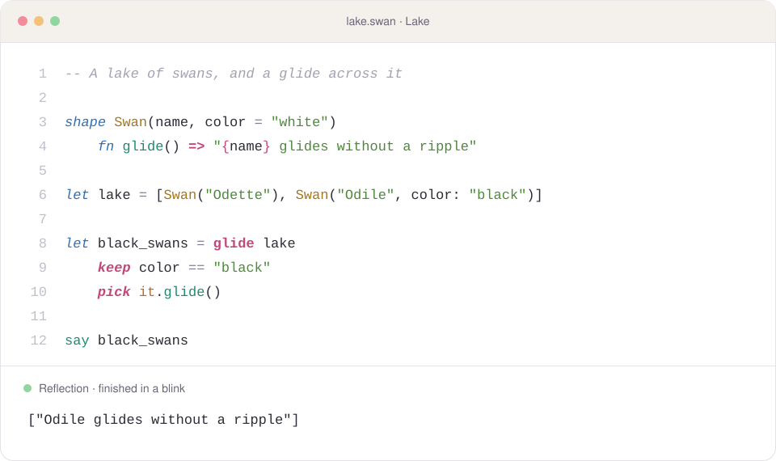

<picture>
  <source media="(prefers-color-scheme: dark)" srcset="assets/banner-dark.svg">
  
</picture>

<p align="center">
  <a href="https://github.com/advaithsajith/swan/actions/workflows/check.yml"></a>
  
  
  
  <a href="LICENSE"></a>
</p>

<p align="center">
  <b>Code that reads like a sentence, glides like a pipeline, and tells you kindly what went wrong.</b>
</p>

<p align="center">
  <a href="https://advaithsajith.github.io/swan/lake/"></a>
</p>

<p align="center">
  <a href="#try-it-in-lake-the-swan-editor">Install it</a> ·
  <a href="GUIDE.md">Learn it</a> ·
  <a href="#the-language">Language tour</a> ·
  <a href="examples">Examples</a>
</p>

<br>

<picture>
  <source media="(prefers-color-scheme: dark)" srcset="assets/code-dark.svg">
  
</picture>

## Why Swan?

<table>
  <tr>
    <td width="33%" valign="top"><h3>💬 Kind errors</h3>Points at the exact spot, explains what went wrong in plain words, and suggests the fix.</td>
    <td width="33%" valign="top"><h3>🌊 glide</h3>Data processing that reads like a sentence: <code>keep</code>, <code>sort</code>, <code>pick</code>, <code>group</code>.</td>
    <td width="33%" valign="top"><h3>🦢 flock</h3>Run several jobs at the same time, safely. Errors never get lost.</td>
  </tr>
  <tr>
    <td valign="top"><h3>🧩 Shapes &amp; abilities</h3>All four pillars of OOP: <code>hidden</code>, <code>from</code>, outlines and polymorphism.</td>
    <td valign="top"><h3>🎯 Choices &amp; match</h3>Swan checks that every case is handled, so a forgotten case can't slip through.</td>
    <td valign="top"><h3>🏞️ Lake editor</h3>Run, test, live error markers, auto-docs, and two themes, all in your browser.</td>
  </tr>
</table>

**New to programming?** Start with [GUIDE.md](GUIDE.md): fifteen short lessons with exercises.

---

## Try it in Lake, the Swan editor

**No install:** open [Lake in your browser](https://advaithsajith.github.io/swan/lake/). Swan runs right
inside the page; your files are saved in your browser.

**On your computer** you only need Python 3.8 or newer. Download this repository, then from its folder run:

```bash
python swan.py lake
```

On Windows you can also type `swan lake`.

Lake opens in your browser and runs only on your computer. You get:

* **Run** (`Ctrl+Enter`), with output shown live in the **Reflection** panel while your program runs.
* **Test** (`Ctrl+Shift+Enter`) runs every `test` block and shows ✓ or ✗ for each.
* **Error markers while you type.** Mistakes get a red squiggle, and the exact line and a hint appear when you run.
* **Docs tab:** documentation for your code, built automatically.
* **Input tab:** answers for programs that use `ask()`.
* **Two themes:** Black Swan (dark) and Swan Lake (light).
* **Typing help:** auto-indent, `Tab` and `Shift+Tab`, `Ctrl+/` to comment out lines, `Ctrl+S` to save, and Stop for programs that never end.

---

## Other ways to run Swan

| Command | What it does |
|---|---|
| `swan lake` | opens the editor |
| `swan program.swan` | runs a program |
| `swan test program.swan` | runs the program's tests |
| `swan docs program.swan` | writes `program.md`, documentation for your code |
| `swan` | opens the playground in the terminal |

Each of these also works as `python swan.py …`.

---

## Swan words

Some of Swan's words come from the lake itself:

| Word | Meaning |
|---|---|
| `glide` | process data step by step, like a swan gliding across water |
| `flock` | run several things at the same time, flying together |
| `shape … from …` | a shape that comes from another one, the way a cygnet comes from a swan |
| `ability` / `can` | what a shape is able to do: `shape Swan can Glide, Sing` |
| **Lake** | the editor |
| **Reflection** | the panel where your program's output appears |
| **Black Swan** / **Swan Lake** | the two themes |

---

## The language

### Values
```swan
let name = "Odette"      -- let: stays the same forever
var count = 0            -- var: allowed to change
count += 1

say "Hello, {name}! Count is {count}."
```
Maths behaves the way you'd expect: `7 / 2` is `3.5`, `6 / 2` is `3`, and `0.1 + 0.2` is `0.3`.

### Functions
```swan
fn greet(who, greeting = "Hello")
    say "{greeting}, {who}."

greet("Siegfried", greeting: "Good evening")

fn square(n) => n * n             -- one-line function
let double = n => n * 2           -- tiny unnamed function
```
The last line of a function is its answer. Functions can be used before they're written.

### Lists, ranges and pipelines
```swan
for n in 1..5          -- 1 to 5
for n in 10..1         -- counts down by itself
for n in 0..100 by 10  -- steps
for i, item in list    -- position and item together

nums |> keep(n => n > 10) |> map(square) |> sum |> say
[n * 2 for n in nums if n > 10]
```

### glide: data processing that reads like a sentence
```swan
let adults = glide people
    keep age >= 18          -- fields are just names inside each step
    sort name               -- or: sort age descending
    pick email              -- turn each one into something else

let cities = glide people
    group city              -- gives {key, items} for each city
    pick "{key}: {length(items)} people"
```
The steps are `keep`, `drop`, `sort`, `pick`, `first`, `last`, `unique`, `reverse` and `group`.
Inside a step, `it` means the whole item.

### Match: a smarter switch
```swan
let size = match n
    0 => "none"
    1..9 => "a few"
    [first, ...rest] => "a list starting with {first}"
    x if x < 0 => "below zero"
    _ => "plenty"
```

### Shapes, families and abilities (polymorphism)
```swan
ability Glide
    fn glide()                                  -- required: every glider writes this
    fn perform() => "{name}: {glide()}"         -- free for every glider

shape Bird(name)
    fn describe() => "{name} is a bird"

shape Swan(name) from Bird can Glide
    fn glide() => "glides without a ripple"

shape Cygnet from Swan                          -- gets everything a Swan has
    fn glide() => "paddles in circles"
    fn describe() => parent.describe() + ", still fluffy"

for thing in [Swan("Odette"), Cygnet("Pip")]
    say thing.perform()                         -- each one glides its own way

if pip is Swan ...                              -- true for Cygnets too
fn race(a: Glide, b: Glide)                     -- accepts anything that can Glide
```
If a shape says it `can Glide` but forgets `glide()`, Swan tells you the moment the program starts.

All four pillars of object-oriented programming are here:

| Pillar | In Swan |
|---|---|
| **Encapsulation** | `hidden` fields and functions: calm above the water, paddling out of sight below |
| **Inheritance** | `shape Cygnet from Swan`, with `parent.` to reach the original |
| **Abstraction** | outline shapes (a `fn` with no body) and abilities |
| **Polymorphism** | one call such as `thing.glide()`, many answers; `is` and ability types |

```swan
shape BoxOffice(show, hidden seats = 100)
    fn sell(count)
        if count > seats then fail "only {seats} left"
        seats -= count

office.seats = 5000     -- ✗ 'seats' is hidden inside BoxOffice.
```

### Choices: one of a few options
```swan
choice Weather
    Sunny
    Rain(mm: number)
    Storm(wind: number, mm: number)

fn advice(today: Weather)
    match today
        Sunny => "Perfect for gliding."
        Rain(mm) => "{mm}mm of rain"
        Storm(wind, _) => "Stay home"
```
**Swan checks that you handled every option.** Forget `Storm`, and Swan says so, even on a sunny day.

### Types, only where you want them
```swan
let age = 16                      -- Swan works out that this is a number
let wingspan: number = 2.3        -- or say so, and Swan guards it
fn area(radius: number) -> number
fn find(name: text) -> number?    -- ? means "or nothing"
if x is number ...
```
A plain `number` can never secretly be `nothing`. The `?` makes "might be missing" visible, and
`?.` and `??` handle it safely:
```swan
say person?.address?.city ?? "unknown"
```

### Refs: pointers without the danger
```swan
var score = 10
let p = ref score
@p += 5                         -- score is now 15

fn add_bonus(target, amount)
    @target += amount
add_bonus(ref score, 100)
```
Refs can never be empty, can never point at something that's gone, and can't change a `let`.

### flock: doing several things at once
```swan
flock
    weather = fetch_weather("Oslo")       -- all three run at the same time
    tickets = fetch_tickets("Swan Lake")
    swans = count_swans()
say weather                               -- all ready here

let task = spawn slow_job()               -- or start one yourself…
say await task                            -- …and collect its answer later
```
Tasks take turns safely, so two tasks can never scramble the same value. If a task fails, its error
always reaches you; Swan never lets it disappear.

### When things go wrong
```swan
try
    risky()
otherwise problem
    say "Caught it: {problem}"

fail "something is wrong"         -- raise your own problem
```

### Tests and docs live next to your code
```swan
--- Works out the area of a circle.
fn area(radius: number) -> number
    pi * radius ** 2

test "area of a unit circle"
    expect round(area(1), 2) == 3.14
```
Lines that start with `---` are documentation. The Docs tab and `swan docs` show them, and so does
`help(area)`. A failing test shows both sides: `left side was 3.14, right side was 3.15`.

---

## Built-in tools

| | |
|---|---|
| **Showing & asking** | `say` `ask` `text` `number` `type` `help` |
| **Numbers** | `round` `floor` `ceil` `abs` `sqrt` `min` `max` `sum` `average` `random` `pi` |
| **Lists** | `length` `map` `keep` `drop` `fold` `find` `any` `all` `count` `sort` `reverse` `unique` `zip` `first` `last` `push` `pop` `insert` `remove` `copy` |
| **Text** | `upper` `lower` `trim` `split` `join` `replace` `chars` `words` `lines` `starts_with` `ends_with` `contains` |
| **Maps** | `keys` `values` `has` `get` |
| **Time & files** | `now` `wait` `read_file` `write_file` |

Any tool can be written with dots: `length(name)` is the same as `name.length()`.

---

## Kind errors

```
✗ I can't add text and a number together.
  in shop.swan, line 2
  2 │ say "There are " + swans + " swans"
                       ^
  hint: To put a value inside text, use braces: "Score: {score}"
```
Swan also notices habits from other languages. Typing `print`, `class`, `self`, `&&` or `null`
gets you the Swan way to say it. Typos get "Did you mean …?"

---

## Examples

| File | Shows |
|---|---|
| [hello.swan](examples/hello.swan) | the smallest program |
| [tour.swan](examples/tour.swan) | every basic feature |
| [pillars.swan](examples/pillars.swan) | the four pillars of OOP, including `hidden` and outlines |
| [polymorphism.swan](examples/polymorphism.swan) | shapes, `from`, abilities, `parent`, `is` |
| [glide.swan](examples/glide.swan) | data processing with `glide` |
| [choices.swan](examples/choices.swan) | choices, complete matches, types and null safety |
| [flock.swan](examples/flock.swan) | running things at the same time |
| [bank.swan](examples/bank.swan) | a small program with tests |
| [fizzbuzz.swan](examples/fizzbuzz.swan) | the classic, Swan-style |

---

## Colours in VS Code

The `vscode-swan` folder adds Swan colours and the Black Swan and Swan Lake themes to VS Code:

```bash
xcopy /E /I vscode-swan "%USERPROFILE%\.vscode\extensions\swan-language"
```

Restart VS Code and open a `.swan` file.

---

## Checking Swan itself

```bash
python tests/check.py
```

This runs 178 good and broken programs through Swan. Each one must give the right answer or a friendly message.
GitHub runs the same checks automatically on Windows, macOS and Linux every time code is pushed.

## License

MIT. See [LICENSE](LICENSE).
